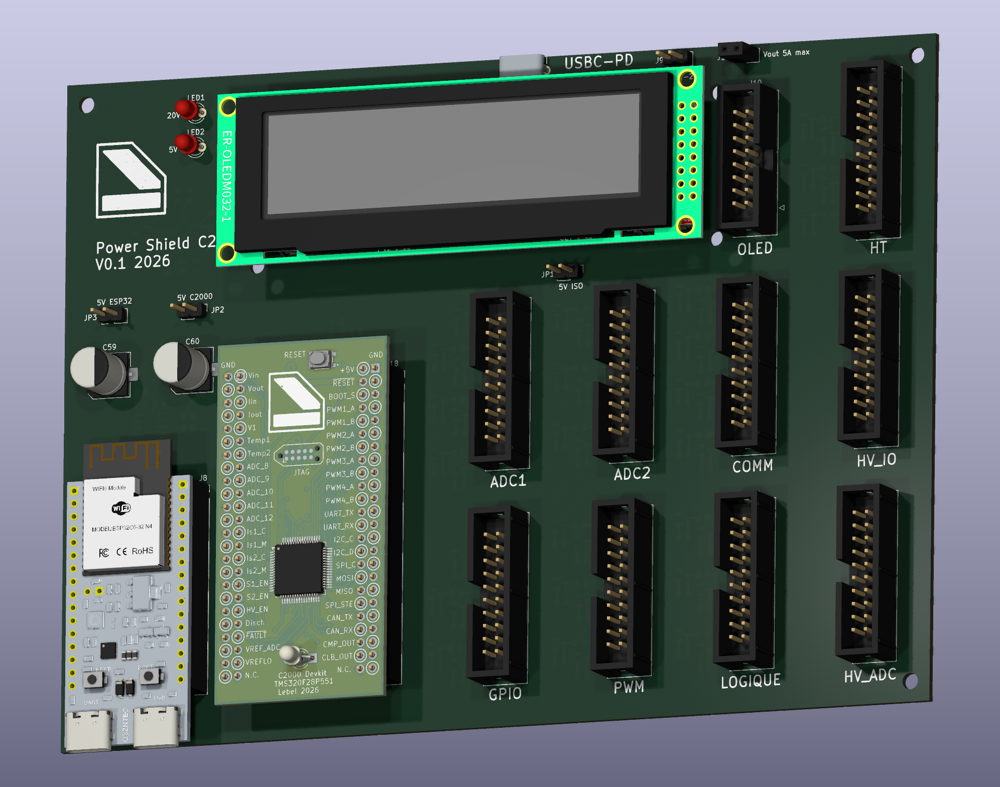

# KICAD-C2000-powershield

Shield d'isolation, alimentation et interconnexion pour TMS320 C2000, conçu
sous KiCad 10.

Reprend le projet `shield` de [`KICAD-C2000-devkit`](https://github.com/Nicolboy/KICAD-C2000-devkit)
au moment où son rôle a dépassé le simple support mécanique des deux
devkits : il reçoit désormais le 11-25V externe et produit lui-même les
rails isolés (5V numérique ×2, 3,3V isolation + protection) qu'une carte
de puissance séparée portait jusque-là. D'où le changement de dépôt plutôt
qu'une extension sur place — `KICAD-C2000-devkit` reste inchangé, c'est
l'état précédent, pas un doublon à synchroniser.

Cible : une commande numérique de convertisseur de puissance isolé, pilotée
par un C2000 et supervisée par un ESP32-C6 pour le Wi-Fi, la mise à jour
FOTA et un écran OLED d'état.

<p align="center">
  
</p>


---

## Architecture

| Carte | Rôle |
|---|---|
| **Shield** | Alimentation complète (11-25V→5V isolé ×2, 3,3V isolation + protection), **alimentation des cartes filles en USB-C Power Delivery** (STUSB4531QTR, 100W/20V/5A, daisy chain), support mécanique des deux devkits, adaptation de brochage, conditionnement analogique, protections, embase OLED |
| **Cartes DC/DC enfichables** | Une par fonction de puissance, portent chacune l'isolation galvanique qu'elle exige (ou aucune), raccordées au shield par les 4 nappes |
| **Devkit C2000** | MCU, deux LDO 3,3V, JTAG, bouton reset, LED, cavalier de boot |
| **Devkit ESP32** | Wi-Fi, hôte FOTA, écran OLED SPI (`ER-OLEDM032-1B`) |

Liaison shield ↔ cartes DC/DC : six nappes IDC 2 × 10 détrompées (backplane
partagé, decision #17), `3V3_ISO`/`GND` en positions 1/2 puis alternance
signal/masse stricte 1:1 sur les positions suivantes. Deux cartes
(HV, Filament) ont en plus leur propre connecteur dédié (decision #26),
leurs besoins dépassant les réserves du backplane partagé. Écran OLED :
nappe IDC 2 × 8 détrompée dédiée, alimentée avec l'ESP32. Détail complet
dans [`doc/nappes-shield.md`](doc/nappes-shield.md).

---

## Alimentation des cartes filles — USB-C Power Delivery (STUSB4531QTR)

Entrée séparée du 11-25V du shield (decision #23) : un port USB-C négocie
jusqu'à 100W (20V/5A) via un STUSB4531QTR autonome — gestion du contrat PD,
coupure (`VBUS_EN_SNK`) et décharge (`DISCH`/`VBUS_VS_DISCH`) sans eFuse
externe, un seul MOSFET P piloté directement. La puissance négociée est
transmise **en daisy chain** aux cartes filles.

Le STUSB4531 expose son bus de configuration/état (I2C : `STUSB_SCL`/
`STUSB_SDA`, alerte `STUSB_ALERT`) à l'ESP32 via un isolateur dédié
(`ISO1640BD`) — l'ESP32 peut ainsi lire la tension/le courant négociés et
réagir aux alertes sans relier directement le domaine USB-C (`GND_PRI`,
decision #27) au domaine de commande. Cette supervision rejoint son rôle
de superviseur Wi-Fi/FOTA déjà confié ailleurs dans le projet.

Détail et justification dans [`doc/decisions.md`](doc/decisions.md)
(#23, #27).

---

## Le brochage est du code

[`doc/spec-devkit.md`](doc/spec-devkit.md) fait autorité pour le connecteur
devkit — 2 × 28 pour devkit_A (hérité de `KICAD-C2000-devkit`, toujours
valable), **deux embases 2 × 24 à masse en vis-à-vis pour devkit_B**
depuis la decision #25 (`doc/decisions.md`) — les deux devkits ne sont
plus compatibles avec le même shield.
[`doc/nappes-shield.md`](doc/nappes-shield.md) décrit les quatre nappes DC/DC
et l'embase OLED. Contrairement au dépôt d'origine, **il n'y a pas de
générateur ici** — `shield.kicad_sch` est édité à la main dès le départ
(`gen_devkit.py` et consorts restent dans `KICAD-C2000-devkit`, hors sujet
pour ce dépôt).

Les schémas ne contiennent aucun fil : toute la connectivité passe par des
étiquettes globales posées exactement sur la broche concernée — convention
commune à tous les projets KiCad de l'atelier, documentée dans
[`../KICAD.md`](../KICAD.md).

---

## Concevoir avec un agent

Une part du travail est faite par un agent : lecture de datasheet, choix de
boîtier et création d'empreinte custom quand nécessaire (ex.
`lib/NCM3S1205MC.kicad_mod`), traitement par lots, étiquetage. Le placement
des composants et le routage restent manuels.

---

## Reproduire

KiCad 10 requis, `kicad-cli` dans le `PATH`.

```bash
kicad-cli sch erc --exit-code-violations shield.kicad_sch
kicad-cli pcb drc --exit-code-violations shield.kicad_pcb
```

---

## État d'avancement

Travail en cours:

- **Schéma** — dix feuilles (connecteurs devkit/ESP32/OLED, nappes DC/DC,
  alimentation, alimentation USB-C PD des cartes filles, connecteurs dédiés
  carte HV et carte Filament, quatre feuilles de chaînes de protection).
  Toutes les broches réelles portent une empreinte. L'ERC reste à quelques
  centaines de violations, de la même famille que le reste de l'atelier
  (`pin_not_connected`, `isolated_pin_label` sur des réserves non pilotées,
  `endpoint_off_grid`) — pas corrigées d'office, voir `doc/decisions.md`.
- **PCB** — **routé à 100 % sur 4 couches**. `3V3_ISO` distribué sur cinq
  régulateurs dédiés (un par groupe de nappes, décision #29 et suivantes)
  plutôt qu'un LDO unique partagé. DRC propre (quelques dizaines de
  violations résiduelles, catégorisées et justifiées — `lib_footprint_mismatch`
  attendu, `courtyards_overlap` mesuré et accepté). 14 points de test posés
  sur les rails d'alimentation, le bus I2C et la paire de référence ADC,
  étiquetés par nom de net sur `F.Silkscreen`.
- **Connecteur devkit C2000/ESP32, nappes DC/DC, embase OLED** — brochage
  figé, labels vérifiés par ERC contre les coordonnées réelles des broches.

Points encore laissés ouverts (référence exacte de certains connecteurs,
budget de courant détaillé) listés en fin de
[`doc/decisions.md`](doc/decisions.md). Ils attendent une lecture de
datasheet ou une mesure, pas une estimation.

---

## Décisions à ne pas défaire

Trente décisions documentées dans [`doc/decisions.md`](doc/decisions.md),
chacune avec sa raison et ce qui casse si on la défait. Héritées de
`KICAD-C2000-devkit` (#1 à #12) ou propres à ce dépôt (#13 à #30 : migration
de la conversion isolée sur le shield, renumérotation des nappes, embase
OLED et assignation des empreintes, connecteurs dédiés carte HV et carte
Filament, alimentation USB-C Power Delivery des cartes filles, isolation
numérique ESP32 ↔ STUSB4531, suiveur de référence ADC bufferisé).

---

## Licence

[CERN-OHL-S v2](LICENSE) — CERN Open Hardware Licence, fortement réciproque.

Tu peux étudier, modifier, fabriquer et distribuer ce matériel. En
contrepartie, si tu distribues un produit fondé dessus, ou une version
modifiée, tu dois publier les sources correspondantes sous la même licence.
